# CampusOps Database & Workbook Analysis Report

**Project:** CampusOps — Intelligent Campus Operations Platform  
**Team:** LOWKEY CODERS | Problem Statement 2 | Overclock'26 Hackathon  
**Authoritative Source:** `data/source/CampusOps_Complete_Fictional_Database_Dataset.xlsx`  
**Date of Inspection:** 2026-10-30  
**Environment:** SQLite + Prisma ORM + Node.js / Express + React Vite TypeScript  

---

## 1. Executive Summary & Workbook Inventory

The source workbook `CampusOps_Complete_Fictional_Database_Dataset.xlsx` contains **35 sheets total**:
- **1 guidance sheet:** `START_HERE` (specifying hackathon context, demo scenarios, business rules, caveats)
- **34 data sheets:** Structured relational tables covering all campus operations, scheduling, incidents, inventory, procurement, and auditing.

All 34 sheets were verified for column headers, row counts, data types, null counts, distinct values, and foreign key integrity.

### Table Inventory Summary

| Table # | Sheet / Table Name | Row Count | Primary Key | Key Attributes & Foreign Keys | Functional Domain |
|---|---|---|---|---|---|
| 01 | `roles` | 7 | `id` (PK, string) | `code` (unique: STUDENT, FACULTY, TECHNICIAN, etc.), `name` | Identity & RBAC |
| 02 | `departments` | 5 | `id` (PK, string) | `name`, `manager_id` (FK -> `users.id`) | Directory |
| 03 | `users` | 38 | `id` (PK, string) | `login_id` (unique), `password_hash`, `name`, `email` (unique), `department_id` (FK -> `departments.id`), `status` | Identity & Auth |
| 04 | `user_roles` | 38 | `(user_id, role_id)` (Composite PK) | `user_id` (FK -> `users.id`), `role_id` (FK -> `roles.id`), `assigned_by` (`users.id` or `'SYSTEM_SEED'`) | RBAC Association |
| 05 | `buildings` | 4 | `id` (PK, string) | `code` (unique: A, B, C, D), `name`, `floors`, `status` | Campus Infrastructure |
| 06 | `rooms` | 78 | `id` (PK, string) | `building_id` (FK -> `buildings.id`), `code` (unique), `capacity`, `room_type`, `status` | Infrastructure |
| 07 | `assets` | 242 | `id` (PK, string) | `asset_tag` (unique), `room_id` (FK -> `rooms.id`), `type`, `status`, `installed_at` | Infrastructure |
| 08 | `skills` | 6 | `id` (PK, string) | `name` (Electrical, Network, HVAC, Plumbing, AV, General) | Staff Operations |
| 09 | `technician_skills` | 9 | `(user_id, skill_id)` (Composite PK) | `user_id` (FK -> `users.id`), `skill_id` (FK -> `skills.id`), `level` (int 1-5) | Staff Operations |
| 10 | `staff_shifts` | 80 | `id` (PK, string) | `user_id` (FK -> `users.id`), `starts_at`, `ends_at` | Scheduling |
| 11 | `staff_leave` | 3 | `id` (PK, string) | `user_id` (FK -> `users.id`), `starts_at`, `ends_at`, `status` (APPROVED, PENDING) | Scheduling |
| 12 | `room_bookings` | 141 | `id` (PK, string) | `room_id` (FK -> `rooms.id`), `department_id` (FK -> `departments.id`), `faculty_id` (FK -> `users.id`), `starts_at`, `ends_at`, `status`, `purpose` | Academic Scheduling |
| 13 | `room_requirements` | 193 | `(booking_id, requirement_type)` (Composite PK) | `booking_id` (FK -> `room_bookings.id`), `requirement_type` (CAPACITY, PROJECTOR, ACCESSIBLE), `value` | Academic Scheduling |
| 14 | `room_outages` | 2 | `id` (PK, string) | `room_id` (FK -> `rooms.id`), `incident_id` (FK -> `incidents.id`), `starts_at`, `ends_at`, `status` | Facilities Coordination |
| 15 | `intake_messages` | 27 | `id` (PK, string) | `channel` (WEB, QR, EMAIL, VOICE), `original_text`, `language`, `reporter_id` (FK -> `users.id`), `external_message_id`, `received_at` | Complaint Intake |
| 16 | `incidents` | 24 | `id` (PK, string) | `reference` (unique), `title`, `category`, `priority`, `status`, `building_id` (FK -> `buildings.id`), `room_id` (FK -> `rooms.id`), `asset_id` (FK nullable -> `assets.id`), `created_at` | Incident Management |
| 17 | `incident_reports` | 27 | `(incident_id, intake_message_id)` (Composite PK) | `incident_id` (FK -> `incidents.id`), `intake_message_id` (FK -> `intake_messages.id`), `relationship_type` (PRIMARY, RELATED) | Incident Management |
| 18 | `incident_links` | 2 | `id` (PK, string) | `source_incident_id` (FK -> `incidents.id`), `target_incident_id` (FK -> `incidents.id`), `relation`, `confidence`, `review_status` | Incident Correlation |
| 19 | `work_orders` | 24 | `id` (PK, string) | `incident_id` (FK -> `incidents.id`), `assigned_to` (FK -> `users.id`), `status`, `required_skill_id` (FK -> `skills.id`), `due_at`, `blocked_reason` | Work Management |
| 20 | `work_order_events` | 28 | `id` (PK, string) | `work_order_id` (FK -> `work_orders.id`), `actor_id` (FK -> `users.id`), `event_type`, `details`, `created_at` | Work History |
| 21 | `maintenance_history` | 2 | `id` (PK, string) | `asset_id` (FK -> `assets.id`), `work_order_id` (FK -> `work_orders.id`), `fault_type`, `resolution`, `completed_at` | Asset Lifecycle |
| 22 | `incident_impacts` | 5 | `id` (PK, string) | `incident_id` (FK -> `incidents.id`), `target_type` (BOOKING, ROOM), `target_id`, `impact_type`, `status` | Impact Assessment |
| 23 | `inventory_items` | 10 | `id` (PK, string) | `sku` (unique), `name`, `unit`, `quantity_on_hand` (int), `reorder_level` (int) | Inventory |
| 24 | `stock_reservations` | 3 | `id` (PK, string) | `item_id` (FK -> `inventory_items.id`), `work_order_id` (FK -> `work_orders.id`), `quantity` (int), `status` (CONSUMED, RELEASED) | Inventory Allocation |
| 25 | `stock_movements` | 13 | `id` (PK, string) | `item_id` (FK -> `inventory_items.id`), `quantity_delta` (int), `reason`, `reference_id`, `created_at` | Inventory Ledger |
| 26 | `purchase_requests` | 4 | `id` (PK, string) | `requester_id` (FK -> `users.id`), `work_order_id` (FK -> `work_orders.id`), `status`, `estimated_total` (float), `reason` | Procurement |
| 27 | `purchase_request_lines` | 4 | `id` (PK, string) | `request_id` (FK -> `purchase_requests.id`), `item_id` (FK -> `inventory_items.id`), `quantity` (int), `estimated_unit_cost` (float) | Procurement |
| 28 | `approval_decisions` | 3 | `id` (PK, string) | `request_id` (FK -> `purchase_requests.id`), `approver_id` (FK -> `users.id`), `decision` (APPROVED, REJECTED), `comment`, `decided_at` | Procurement Governance |
| 29 | `stock_receipts` | 1 | `id` (PK, string) | `purchase_request_id` (FK -> `purchase_requests.id`), `item_id` (FK -> `inventory_items.id`), `quantity_received`, `received_by` (FK -> `users.id`), `received_at`, `condition` | Physical Receiving |
| 30 | `sla_policies` | 4 | `id` (PK, string) | `priority` (unique: LOW, MEDIUM, HIGH, CRITICAL), `response_minutes`, `resolution_minutes` | Service Level Management |
| 31 | `notifications` | 4 | `id` (PK, string) | `recipient_id` (FK -> `users.id`), `event_type`, `title`, `body`, `read_at` (nullable datetime) | Operations & Alerts |
| 32 | `outbox_events` | 3 | `id` (PK, string) | `event_key` (unique), `event_type`, `payload` (JSON), `status` (DELIVERED, PENDING), `attempts` | Event-Driven Outbox |
| 33 | `audit_logs` | 6 | `id` (PK, string) | `actor_id` (FK -> `users.id`), `action`, `entity_type`, `entity_id`, `before_json` (JSON), `after_json` (JSON), `created_at` | Compliance & Security |
| 34 | `idempotency_keys` | 2 | `key` (PK, string) | `operation`, `request_hash`, `result_json` (JSON), `created_at` | API Safety |

---

## 2. Relational Integrity & Data Quality Findings

### 2.1 The `SYSTEM_SEED` Attribution in `user_roles`
- In `user_roles` row 30: `user_id = 'USR029'` (System Admin Aisha Rahman), `role_id = 'ROLE05'` (SYSTEM_ADMIN), `assigned_by = 'SYSTEM_SEED'`.
- All other 37 rows in `user_roles` have `assigned_by = 'USR029'`.
- **Finding:** In pure relational algebra, `'SYSTEM_SEED'` does not exist in `users.id`.
- **Resolution:** `assigned_by` should be modeled in Prisma as `String?` without an enforced foreign-key constraint to `users.id`, or as a nullable relation to `User` where `'SYSTEM_SEED'` can be represented or preserved as a designated actor string.

### 2.2 Circular Dependency: `departments` <-> `users`
- Every `department` defines `manager_id` pointing to a `user` (e.g. `USR024` through `USR028`).
- Every `user` defines `department_id` pointing to a `department` (`DEP01` through `DEP05`).
- **Finding:** Neither table can be inserted first if both foreign keys are mandatory at insert time.
- **Resolution:** In Prisma and the Excel importer, `departments.manager_id` will be defined as an optional relation (`String?`). The importer executes in two steps:
  1. Insert `departments` with `manager_id = null`.
  2. Insert `users` with their `department_id`.
  3. Update `departments` with their respective `manager_id`.
  This guarantees 100% referential integrity without turning off SQLite FK constraints.

### 2.3 Polymorphic Foreign Keys
1. **`incident_impacts`:**
   - Contains `target_type` (`'ROOM'` or `'BOOKING'`) and `target_id` (`'RM-B-204'` or `'BKG-EXAM'`).
   - Verified that all `target_id` values exist: `'BKG-EXAM'` is in `room_bookings`, and `'RM-B-204'`, `'RM-C-201'`, `'RM-C-202'`, `'RM-C-203'` are in `rooms`.
   - In Prisma, `target_id` is stored as `String` with `target_type` indexed. Helper relations can be queried programmatically.
2. **`stock_movements`:**
   - Contains `reference_id` which references `'SEED-2026'` (for opening balance), a Work Order ID (e.g. `'WO001'`, `'WO002'`), or a Purchase Request ID (`'PR001'`).
   - In Prisma, `reference_id` is stored as `String`.

### 2.4 Inventory Ledger Reconciliation
- Verified that for all 10 items in `inventory_items`, `quantity_on_hand` **exactly equals** the sum of all `quantity_delta` in `stock_movements`.
- The ledger is mathematically airtight.
- `stock_reservations` records:
  - `RSV001`: ITM001, WO001, quantity 1, status: `CONSUMED`
  - `RSV002`: ITM002, WO002, quantity 1, status: `CONSUMED`
  - `RSV003`: ITM003, WO002, quantity 2, status: `RELEASED`
- **Business Rule:** Only `ACTIVE` reservations reduce available quantity. `CONSUMED` and `RELEASED` are historical snapshots.

### 2.5 Password Hashes & Demo Authentication
- The workbook stores placeholder `'REPLACE_WITH_ARGON2_HASH'` for all 38 users.
- Prompt specifies: **`bcryptjs` for password hashing with cost factor 12** and configurable `DEMO_PASSWORD` from `.env`.
- **Resolution:** The importer will hash the configured demo password (e.g. `CampusOps@2026!`) with `bcryptjs` (salt rounds: 12) and store valid hashes so all 38 demo accounts can log in immediately.

### 2.6 Timestamps & Date Formatting
- All 80 shift rows, 141 booking rows, 24 incidents, 28 events, and audit logs use clean ISO 8601 strings: `YYYY-MM-DDTHH:mm:ss`.
- All timestamps represent the local campus demo timeline (November 2026, Asia/Kolkata).
- Importer will parse them into standard JavaScript `Date` objects for Prisma `DateTime`.

---

## 3. Import Dependency Order (Acyclic Graph)

To guarantee zero foreign key violations during seeding:

```mermaid
flowchart TD
    subgraph Level0["Level 0: Independent Master Data"]
        roles["roles (7)"]
        buildings["buildings (4)"]
        skills["skills (6)"]
        inventory_items["inventory_items (10)"]
        sla_policies["sla_policies (4)"]
        idempotency_keys["idempotency_keys (2)"]
    end

    subgraph Level1["Level 1: Campus Directory Core"]
        departments_step1["departments (5) [manager_id=NULL]"]
        rooms["rooms (78)"]
        users["users (38)"]
        departments_step2["departments [UPDATE manager_id]"]
    end

    subgraph Level2["Level 2: Staff, Bookings & Messages"]
        user_roles["user_roles (38)"]
        assets["assets (242)"]
        technician_skills["technician_skills (9)"]
        staff_shifts["staff_shifts (80)"]
        staff_leave["staff_leave (3)"]
        room_bookings["room_bookings (141)"]
        intake_messages["intake_messages (27)"]
    end

    subgraph Level3["Level 3: Requirements & Incidents"]
        room_requirements["room_requirements (193)"]
        incidents["incidents (24)"]
    end

    subgraph Level4["Level 4: Outages & Work Orders"]
        room_outages["room_outages (2)"]
        incident_reports["incident_reports (27)"]
        incident_links["incident_links (2)"]
        incident_impacts["incident_impacts (5)"]
        work_orders["work_orders (24)"]
    end

    subgraph Level5["Level 5: Work Events & Inventory Reservations"]
        work_order_events["work_order_events (28)"]
        maintenance_history["maintenance_history (2)"]
        stock_reservations["stock_reservations (3)"]
        purchase_requests["purchase_requests (4)"]
    end

    subgraph Level6["Level 6: Procurement Lifecycle & Ledger"]
        stock_movements["stock_movements (13)"]
        purchase_request_lines["purchase_request_lines (4)"]
        approval_decisions["approval_decisions (3)"]
        stock_receipts["stock_receipts (1)"]
    end

    subgraph Level7["Level 7: Operations & System Outbox"]
        notifications["notifications (4)"]
        outbox_events["outbox_events (3)"]
        audit_logs["audit_logs (6)"]
    end

    buildings --> rooms
    departments_step1 --> users
    users --> departments_step2
    users --> user_roles
    roles --> user_roles
    rooms --> assets
    users --> technician_skills
    skills --> technician_skills
    users --> staff_shifts
    users --> staff_leave
    rooms --> room_bookings
    users --> room_bookings
    users --> intake_messages
    room_bookings --> room_requirements
    buildings --> incidents
    rooms --> incidents
    assets -.-> incidents
    incidents --> room_outages
    rooms --> room_outages
    incidents --> incident_reports
    intake_messages --> incident_reports
    incidents --> incident_links
    incidents --> incident_impacts
    incidents --> work_orders
    users --> work_orders
    skills --> work_orders
    work_orders --> work_order_events
    assets --> maintenance_history
    work_orders --> maintenance_history
    inventory_items --> stock_reservations
    work_orders --> stock_reservations
    inventory_items --> stock_movements
    work_orders --> purchase_requests
    users --> purchase_requests
    purchase_requests --> purchase_request_lines
    inventory_items --> purchase_request_lines
    purchase_requests --> approval_decisions
    users --> approval_decisions
    purchase_requests --> stock_receipts
    inventory_items --> stock_receipts
    users --> stock_receipts
    users --> notifications
    users --> audit_logs
```

---

## 4. Proposed Prisma Model Design Highlights

### Composite Primary Keys:
1. `UserRole`: `@@id([userId, roleId])`
2. `TechnicianSkill`: `@@id([userId, skillId])`
3. `RoomRequirement`: `@@id([bookingId, requirementType])`
4. `IncidentReport`: `@@id([incidentId, intakeMessageId])`

### Unique Constraints:
- `Role.code`
- `Building.code`
- `Room.code`
- `User.loginId`
- `User.email`
- `Asset.assetTag`
- `Incident.reference`
- `InventoryItem.sku`
- `SlaPolicy.priority`
- `OutboxEvent.eventKey`

### Status Enums (Modeled with strict types & Zod validation):
- `UserStatus`: `ACTIVE`, `INACTIVE`
- `RoomType`: `CLASSROOM`, `LAB`, `SEMINAR`
- `StaffLeaveStatus`: `APPROVED`, `PENDING`, `REJECTED`
- `IncidentPriority`: `LOW`, `MEDIUM`, `HIGH`, `CRITICAL`
- `IncidentStatus`: `NEW`, `TRIAGED`, `ASSIGNED`, `IN_PROGRESS`, `RESOLVED`, `CLOSED`
- `WorkOrderStatus`: `OPEN`, `ASSIGNED`, `IN_PROGRESS`, `BLOCKED`, `COMPLETED`, `CANCELLED`
- `PurchaseRequestStatus`: `PENDING_APPROVAL`, `APPROVED`, `REJECTED`, `RECEIVED`
- `StockReservationStatus`: `ACTIVE`, `CONSUMED`, `RELEASED`
- `ApprovalDecisionType`: `APPROVED`, `REJECTED`

---

## 5. Schema Decisions Requiring User Approval

1. **`user_roles.assigned_by` Constraint:**
   - **Recommendation:** Define `assigned_by String?` without an enforced foreign key to `users(id)`, allowing `'SYSTEM_SEED'` for the bootstrap administrator and user IDs for administrative role assignments.
2. **Circular Reference Handling:**
   - **Recommendation:** Define `Department.managerId` as optional `String?` with optional relation `manager User? @relation("DepartmentManager", fields: [managerId], references: [id])`. Use a two-pass import for `departments` and `users`.
3. **Polymorphic Fields (`IncidentImpact`, `StockMovement`):**
   - **Recommendation:** Maintain standard string identifiers with type discriminators matching workbook structure (`target_type` / `target_id` and `reason` / `reference_id`), indexing them for sub-millisecond lookups.
4. **Password Hashing Strategy:**
   - **Recommendation:** Apply `bcryptjs` with cost factor 12 to hash the configurable `DEMO_PASSWORD` from `.env` (defaulting to `CampusOps@2026!`), ensuring all 38 accounts are authenticatable out of the box.

---
*Analysis completed with 0 data discards and full integrity verified.*
