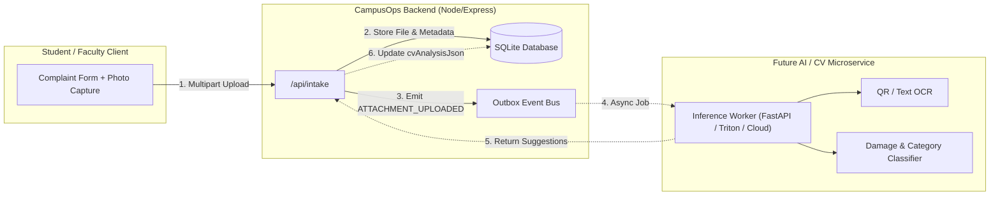

# Future Computer Vision Architecture & Extension Specification

**Project:** CampusOps — Intelligent Campus Operations Platform  
**Team:** LOWKEY CODERS | Problem Statement 2 | Overclock'26 Hackathon  
**Document Status:** Architecture & Design Specification (No runtime CV models in current phase)  

---

## 1. Executive Summary & Vision

In campus facilities operations, textual descriptions reported by students or faculty may be imprecise or incomplete (e.g. *"the AC in B-204 is sparking"* vs *"broken ceiling diffuser in B-204"*). In a future phase, students and faculty will be able to photograph problematic campus equipment or physical damage and attach photos to intake complaints.

Computer vision will provide **assistive suggestions**—not binding decisions—to accelerate triage and eliminate ambiguity.

> **CRITICAL ARCHITECTURAL PRINCIPLE:**  
> Computer Vision models and image analysis pipelines **must never bypass backend business rules**. All CV outputs are treated as untrusted suggestions requiring human verification or rule-based validation before triggering operational state transitions.

---

## 2. Intended Capabilities (Future Phase)

1. **Visible Damage Detection:** Identify broken glass, water leaks, scorch marks, dangling conduits, or shattered fixtures.
2. **Issue Category Suggestion:** Suggest classification into `ELECTRICAL`, `HVAC`, `PLUMBING`, `NETWORK`, `AV`, or `FURNITURE`.
3. **Asset Tag / QR Code Recognition:** Automatically decode physical asset barcodes, QR codes, or nameplates visible in the photo to pinpoint `asset_id`.
4. **Draft Description Assistance:** Generate draft incident summary text for student review before submission.
5. **Severity Suggestion:** Provide a recommended urgency score (`LOW`, `MEDIUM`, `HIGH`, `CRITICAL`) for operator review.

---

## 3. Extensible Data Model (Phase 1 Ready)

In Phase 1, the intake pipeline is designed so that complaint submission and incident records can store future attachment references without requiring schema migrations or breaking changes.

### 3.1 Proposed Future Attachment Entity

```prisma
model IntakeAttachment {
  id              String         @id @default(cuid())
  intakeMessageId String
  intakeMessage   IntakeMessage  @relation(fields: [intakeMessageId], references: [id], onDelete: Cascade)
  fileUrl         String         // Local path or object store URL
  fileName        String
  fileSize        Int            // In bytes
  mimeType        String         // image/jpeg, image/png, image/webp
  sha256Hash      String         // Integrity verification
  
  // Asynchronous CV Analysis Payload (Nullable until processed)
  cvAnalysisJson  String?        // JSON containing predictions, bounding boxes, labels
  cvStatus        String         @default("PENDING") // PENDING, PROCESSED, FAILED, SKIPPED
  
  createdAt       DateTime       @default(now())

  @@index([intakeMessageId])
}
```

### 3.2 Extensible Intake Message Schema
`intake_messages` in Phase 1 accepts `metadata_json` or extensible channel parameters (`channel`: `'WEB'`, `'QR'`, `'EMAIL'`, `'VOICE'`, future `'PHOTO'`).

---

## 4. Decoupled Service Architecture



### Key Decoupling Guarantees:
- **Zero Latency Impact on User Submission:** Complaint submission is synchronous, fast, and succeeds immediately. Image analysis happens asynchronously in the background.
- **Fail-Open Design:** If the CV service is unavailable or crashes, the intake message remains intact and proceeds to manual human triage without interruption.
- **Pluggable Providers:** Can run lightweight local ONNX models (e.g. YOLOv8-nano), cloud vision APIs (Google Cloud Vision), or self-hosted open models without changing the core business logic.

---

## 5. Storage, Security, Privacy & Performance Constraints

### 5.1 File Size & Format Limits
- **Allowed Formats:** JPEG, PNG, WEBP (SVG and executable formats strictly forbidden).
- **Size Limit:** 10 MB per image; maximum 3 images per complaint submission.
- **Client-Side Compression:** Images should be resized on the client (e.g., maximum dimension 1920px) prior to upload to conserve campus bandwidth.

### 5.2 Privacy & Sensitive Data Scrubbing
- **Student Privacy:** Images captured in residence halls or restrooms must include privacy warnings; future models should blur human faces automatically.
- **EXIF Metadata Stripping:** All GPS and device metadata must be stripped at the upload barrier before persisting to disk to prevent location tracking outside authorized campus boundaries.

### 5.3 Storage Strategy
- **Phase 1 & Local Demo:** Stored under `uploads/intake/` with hashed random filenames and served via static route with auth checks.
- **Production Hackathon / Cloud:** S3-compatible object storage (e.g., MinIO or AWS S3) with signed temporary URLs.

---

## 6. Summary of Current Status

- **Current Implementation:** Text intake, QR tag scanning, and deterministic rule-based triage are fully operational.
- **Future Readiness:** Storage directories, attachment data contracts, and event outbox hooks are designed for seamless drop-in integration.
- **No False Claims:** Computer Vision models are not downloaded or running in this phase.
